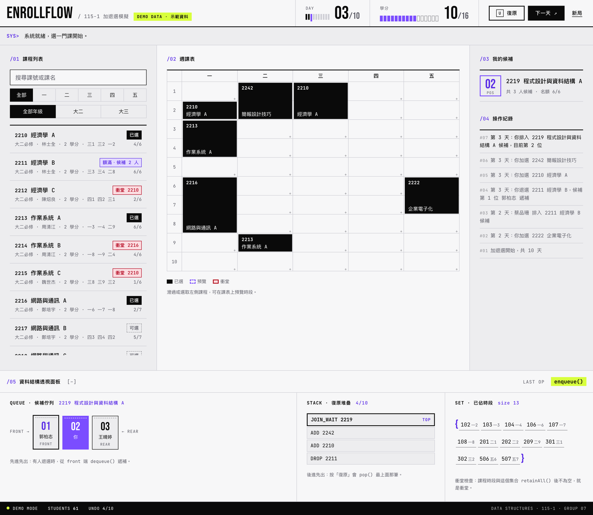

# EnrollFlow 選課候補模擬器

在瀏覽器裡跑十天加退選，看候補佇列怎麼遞補。淡江資管「資料結構」115-1 期末作品，第 07 組。

**線上版：<https://nicktodj-boop.github.io/enrollflow/>**（首次需要載入Java 的 CheerpJ）



## 玩法

你是一位大二學生，和 60 位模擬同學一起搶 34 門淡江資管 115-1 的真實課程。

- 加退選共 10 天，按「下一天」往前推進，同學每天也會加選、排候補、退選。
- 學分要在 10 到 16 之間；第 10 天結束時低於 10 學分，會出現失敗畫面。
- 不能衝堂，同一科只能選一班；額滿的課可以排候補。
- 有人退選時，系統從候補隊伍最前面開始遞補。排第一位也不保證選上：輪到你時如果衝堂或學分已滿，名額會交給下一位。
- 選錯了可以復原，最多 10 步；按「下一天」後，前一天的操作就不能復原。

鍵盤快捷鍵：`U` 復原、`R` 打開或關閉規則、`Esc` 關閉。

## 用到的資料結構

五種結構都用 `java.util`，畫面下方的「資料結構透視面板」會即時顯示佇列、堆疊和集合的內容。

| 結構 | 實作 | 用在哪裡 | 主要操作 |
|---|---|---|---|
| 佇列 Queue | `LinkedList` | 額滿課程的候補名單 | `offer()`、`poll()` |
| 堆疊 Stack | `ArrayDeque` | 復原上一步 | `push()`、`pop()` |
| 集合 Set | `LinkedHashSet` | 自己已佔用的時段，取交集判斷衝堂 | `retainAll()` |
| 字典 Map | `LinkedHashMap` | 用課號查課程 | `get()` |
| 清單 List | `ArrayList` | 課程總表、搜尋結果、操作紀錄 | `add()` |

## 執行方式

### 1. Open Project（終端機版）

用 NetBeans、IntelliJ IDEA、Eclipse 或 VS Code 開啟這個資料夾（Maven 專案，設定檔是 `pom.xml`），執行 `g9.enrollflow.Main`。

- 需要 JDK 9 以上：程式守 Java 8 語法，`pom.xml` 用 `maven.compiler.release = 8` 編譯，這個參數要 JDK 9 以上才支援。
- IDE 會依 `pom.xml` 自動下載 JUnit。

### 2. 指令列（不用 Maven）

```bash
javac --release 8 -encoding UTF-8 -d out $(find src/main/java -name '*.java')
java -cp out g9.enrollflow.Main
```

進入後輸入字母操作：

```
===== EnrollFlow：資料結構選課候補模擬器 =====
------------------------------------------------
 第 1 / 10 天　學分 0 / 16　可復原 0 步
 已選：（無）
 候補：（無）
 C 課程列表  A 加選  D 退選  W 排候補  L 取消候補  U 復原  N 下一天  Q 離開
> 課號 > [OK] 加選成功：2210 經濟學 A，目前 2 學分
```

### 3. 在本機跑網頁版

網頁版的畫面是 HTML／JavaScript，選課規則與資料結構全部在 Java，經由 CheerpJ 在瀏覽器裡執行。

```bash
./run.sh
```

`run.sh` 會先執行 `build.sh`，把 Java 以 Java 8 bytecode 編到 `docs/`，再用 `server.py` 開本機伺服器，瀏覽器打開 <http://localhost:8001/>。Windows 用 `build.bat` 編譯後執行 `python server.py 8001`。

網址加上 `?demo`（例如 <http://localhost:8001/?demo>）會讀 `docs/demo-state.json` 的示範狀態，不載入 Java，用來看畫面。

### 4. 測試

`src/test/java` 有 25 項 JUnit 5 測試：

- `CourseSystemTest`：加選、退選、候補、遞補、復原與各種邊界情況（額滿、衝堂、超過學分、同科目、找不到課號等）。
- `SimulationInvariantTest`：300 局隨機操作，每一步檢查課程名單、候補佇列、學生課表與學分彼此一致。

在 IDE 執行 `src/test/java`，或用 Maven 執行 `mvn test`。

## 專案結構

```
enrollflow/
├── pom.xml                 Maven 設定（Java 8、主程式 g9.enrollflow.Main）
├── src/main/java/g9/enrollflow/
│   ├── CourseSystem.java   對外入口：加選、退選、候補、復原、下一天，所有規則集中在這裡
│   ├── Course.java         一門課：名額、時段、候補佇列 Queue
│   ├── Student.java        一位學生：已選課程、已佔時段 Set、學分
│   ├── Simulator.java      60 位模擬同學每天的行動
│   ├── Action.java         復原堆疊裡的一筆操作
│   ├── CourseData.java     34 門真實課程資料
│   ├── ConsoleUI.java      終端機版介面
│   └── Main.java           程式進入點
├── src/test/java/          JUnit 測試
├── docs/                   網頁版（GitHub Pages 從這裡發布，含編好的 .class）
├── build.sh / build.bat    編譯網頁版
├── run.sh                  編譯並啟動本機伺服器
└── server.py               支援 Range 請求的本機伺服器（CheerpJ 需要）
```

每個類別與方法都有 Javadoc，資料結構操作的地方註明用途。


## 參考

- 課程資料：淡江大學資訊管理學系 115-1 大二、大三課程，名額縮成 5 到 8 人，讓候補一定會發生；模擬同學的姓名為虛構
